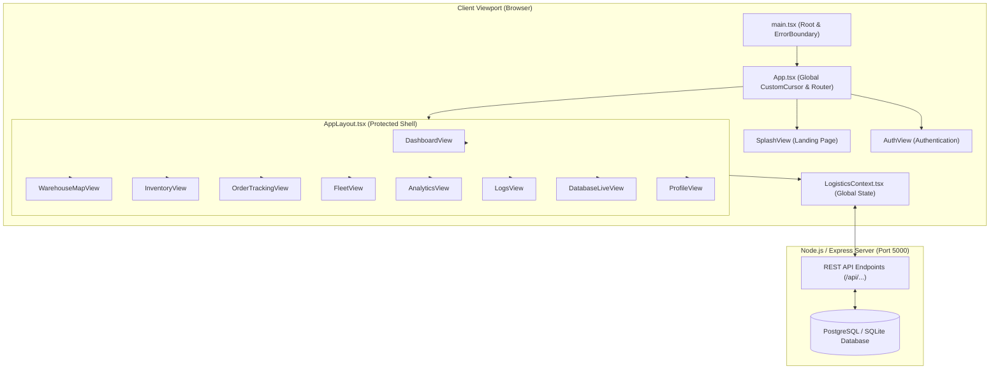

# Frontend Architecture & Component Documentation
**Project:** Autonomous Logistics Mission Control (DE-Project)  
**Stack:** React 19 · TypeScript 5.9 · Vite 8 · Tailwind CSS v4 · Framer Motion 12 · Lucide Animated · Leaflet  

---

## 1. Executive Summary & Design System

The frontend is an **Industrial Cybernetic / Tactical HUD** mission-control interface designed for pan-India logistics, autonomous freight haulage, and Dijkstra route optimization.

### 1.1 Color Tokens & Palette (`frontend/src/index.css`)

| Token | Hex / Value | Semantic Role |
| :--- | :--- | :--- |
| `--bg` | `#06080a` | Deep space black; primary viewport canvas |
| `--bg2` | `#0d1114` | Bento card background; terminal surface |
| `--bg3` | `#141a20` | Secondary surface / elevated panel |
| `--ink` | `#eef2e6` | Primary high-contrast text |
| `--mut` | `#7f8a79` | Muted olive-gray telemetry labels, borders |
| `--volt` | `#c8ff2e` | Signature neon volt yellow-green; optimal capacity, primary CTAs |
| `--hot` | `#ff5a1f` | Tactical orange / amber; near-full capacity, urgent states |
| `--ok` | `#3ddc84` | Emerald green; active online status, verified FIDO2 |
| `--cyan` | `#00f0ff` | Neon cyan; CANBus telematics, live GPS links, active transit |
| `--red` | `#ff4444` / `#ff2d55` | Critical alert red; capacity > 85%, system errors, pinging indicators |
| `--line` | `rgba(255, 255, 255, 0.09)` | Subtle micro-hairline borders |

### 1.2 Typography System

- **`Syne`** (`font-['Syne']` / `.d`): Ultra-bold, geometric, technical display font for hero banners, view titles, and massive KPI numbers.
- **`JetBrains Mono` / `Oxanium` / `Rajdhani`** (`font-mono` / `.m`): Tactical monospaced typography for telemetry coordinates, SKU IDs, JSON payloads, timestamps, and data chips.
- **`Manrope`**: High-legibility sans-serif for body copy, paragraphs, and descriptions.

### 1.3 Micro-Interaction & Motion Primitives

1. **Magnetic Dual-Layer Cursor (`CustomCursor.tsx`):**
   - Active across all pages at the root level (`App.tsx`).
   - Features a high-precision center dot and a lag-smoothed ring with `mix-blend-mode: difference`.
   - Injects `--mx` and `--my` mouse coordinates into hovered cards to drive realistic dynamic radial spotlights (`.card-bento::before`).
   - Scales up magnetically over clickable buttons (`[data-mag]`, `a`, `button`).
2. **3D Spring Tilt (`TiltCard.tsx`):**
   - Physical card elevation using Framer Motion springs (`stiffness: 240, damping: 25`).
   - Dynamically calculates rotation up to `±5°` along X/Y axes based on mouse position.
3. **Organic HUD Typewriter (`TypewriterText.tsx`):**
   - Micro-jitter timing chain (not `setInterval`) with a blinking `█` terminal block.
4. **Scanned Neon Title Sweep (`ScannedTitle.tsx`):**
   - High-voltage neon scanline sweep (`.scan-once`) running top-to-bottom on page entrance.
5. **Count-Up Numbers (`CountUp.tsx`):**
   - `requestAnimationFrame` with `easeOutQuart` cubic easing for dynamic metrics.
6. **3-State Action Button (`MorphButton.tsx`):**
   - Seamlessly morphs between `idle` (label + icon), `loading` (neon spinner), `success` (animated checkmark), and `error` (tactile red shake).
7. **Spring Progress Bars with Neon Glow Caps (`.bar-glow-head`):**
   - Spring-driven progress bars with intense neon tip glow heads instead of flat static bars.
8. **Subtle Film Grain Texture (`body::after`):**
   - SVG turbulence noise overlay (`opacity: 0.06`) providing physical analog hardware depth.

---

## 2. Full Directory & File Structure

```text
frontend/
├── index.html                   # HTML entry point, Google Fonts preconnect (Syne, Manrope, JetBrains Mono)
├── package.json                 # Dependencies (React 19, Framer Motion, Tailwind CSS v4, Lucide Animated)
├── tsconfig.json                # TypeScript strict configuration (ESM, verbatimModuleSyntax)
├── vite.config.ts               # Vite build config with Tailwind & React plugins
└── src/
    ├── main.tsx                 # React DOM root render, BrowserRouter, LogisticsProvider wrapper
    ├── App.tsx                  # Root router, global CustomCursor mount, route guards
    ├── index.css                # Tailwind CSS v4 setup, color tokens, keyframe animations, HUD classes
    ├── api.ts                   # TypeScript interfaces (Warehouse, Order, Product, etc.) & Axios HTTP client
    │
    ├── contexts/
    │   └── LogisticsContext.tsx # Global application state (Auth, User Role, Products, Drivers, Vehicles, Logs)
    │
    ├── components/
    │   ├── MapUI.tsx            # Leaflet-based interactive OpenStreetMap with warehouse markers & clusters
    │   ├── QuickDispatchModal.tsx # Global popup modal to dispatch shipments with Dijkstra preview & MorphButton
    │   │
    │   ├── common/              # Reusable atomic UI & motion components
    │   │   ├── CountUp.tsx        # Eased rAF numeric ticker
    │   │   ├── CustomCursor.tsx   # Interactive magnetic spotlight cursor
    │   │   ├── ErrorBoundary.tsx  # React crash safety guard with cybernetic error screen
    │   │   ├── MorphButton.tsx    # 3-state morphing button (idle/loading/success/error)
    │   │   ├── NetworkCanvas.tsx  # 60 FPS HTML5 Canvas graph visualizer with ambient transit trucks
    │   │   ├── networkData.ts     # Indian logistics graph coordinates (14 Hubs, 21 highway edges)
    │   │   ├── ScannedTitle.tsx   # Title wrapper with HUD neon scanline sweep
    │   │   ├── StaggerGrid.tsx    # Framer Motion staggered entrance container & variants
    │   │   ├── TiltCard.tsx       # 3D interactive tilt container with spotlight reflection
    │   │   └── TypewriterText.tsx # Terminal typewriter effect with organic jitter & blinking cursor
    │   │
    │   ├── layout/              # Structural shells
    │   │   ├── AppLayout.tsx      # Authenticated layout: hover-expandable sidebar, screen wipe, topbar
    │   │   └── Topbar.tsx         # Legacy / fallback topbar navigation
    │   │
    │   └── views/               # Primary application page screens
    │       ├── SplashView.tsx       # Public Landing Page: Hero, 60 FPS Network preview, metrics, CTA
    │       ├── AuthView.tsx         # Login & Registration cockpit with FIDO2 / role selector
    │       ├── DashboardView.tsx    # Mission Control: Telemetry ticker, 4 KPI cards, activity log, charts
    │       ├── WarehouseMapView.tsx # Indian Hubs: 60FPS Canvas, OSM map, Terminal Inspector, 14 terminal cards
    │       ├── InventoryView.tsx    # Autonomous Warehouse Inventory: Stock table, search, Add Item drawer
    │       ├── OrderTrackingView.tsx# Orders & Dijkstra: Expandable rows, milestones, route inspector, dispatch
    │       ├── FleetView.tsx        # Fleet & Drivers: 5s live GPS jitter, CANBus ping, truck oscillation, star rating
    │       ├── AnalyticsView.tsx    # Performance KPIs: 7-day delivery volume bar chart, route efficiency, SLA
    │       ├── LogsView.tsx         # Real-time streaming audit logs with severity borders & live filters
    │       ├── DatabaseLiveView.tsx # Database Table Inspector: Table switcher, SQL runner, JSON row expansion
    │       └── ProfileView.tsx      # Operator identity, security clearance, API token generator
```

---

## 3. Deep File-by-File Breakdown

### 3.1 Root & Configuration Files

#### [`frontend/src/main.tsx`](file:///d:/DEL%20Project/DE-Project/frontend/src/main.tsx)
- **Role:** Application Bootstrap.
- **Responsibilities:**
  - Mounts React 19 root into `#root`.
  - Wraps tree with `<BrowserRouter>` and `<LogisticsProvider>`.
  - Encloses application within `<ErrorBoundary>` to catch unhandled runtime errors without crashing the browser.

#### [`frontend/src/App.tsx`](file:///d:/DEL%20Project/DE-Project/frontend/src/App.tsx)
- **Role:** Route Orchestration & Global Layer.
- **Responsibilities:**
  - Renders `<CustomCursor />` at top level so that the cursor is active on the landing page, login page, and inside dashboard views.
  - Declares public routes (`/` for `SplashView`, `/auth` for `AuthView`).
  - Declares protected route group wrapped in `<AppLayout />` requiring `isAuthenticated`:
    - `/dashboard` → `DashboardView`
    - `/map`, `/warehouses` → `WarehouseMapView`
    - `/inventory` → `InventoryView`
    - `/orders` → `OrderTrackingView`
    - `/fleet` → `FleetView`
    - `/analytics` → `AnalyticsView`
    - `/logs` → `LogsView`
    - `/database-view`, `/admin` → `DatabaseLiveView`
    - `/profile` → `ProfileView`
  - Fallback redirect route (`*` → `/`).

#### [`frontend/src/index.css`](file:///d:/DEL%20Project/DE-Project/frontend/src/index.css)
- **Role:** Global Style Sheet & Design System.
- **Key Features:**
  - Tailwind CSS v4 directive (`@import "tailwindcss"`).
  - CSS custom properties (`--bg`, `--volt`, `--ink`, `--mut`, `--cyan`, etc.).
  - Responsive cursor hiding (`@media (hover: hover) and (min-width: 768px) { body { cursor: none; } }`).
  - Keyframe animations:
    - `@keyframes hud-scan`: Vertical beam pass across titles.
    - `@keyframes scroll-ticker`: Continuous horizontal marquee scroll.
    - `@keyframes border-pulse-critical`: Red border pulsing for overloaded facilities.
    - `@keyframes cursor-blink`: 1s step-end terminal cursor blink.
    - `@keyframes logo-spin`: 405-degree continuous rotating volt diamond.
  - Component classes: `.btn-volt`, `.chip`, `.card-bento`, `.input-dark`, `.bar-glow-head`, `.ticker-fade`.

#### [`frontend/src/api.ts`](file:///d:/DEL%20Project/DE-Project/frontend/src/api.ts)
- **Role:** API Client & TypeScript Domain Types.
- **Exports:**
  - Axios instance configured with `baseURL: 'http://localhost:5000/api'`.
  - Type definitions: `Warehouse`, `Order`, `InventoryItem`, `Product`, `Driver`, `Vehicle`, `ActivityLog`, `OrderTracking`, `Edge`, `Location`.
  - REST helpers: `getWarehouses()`, `getOrders()`, `createOrder()`, `calculateShortestPath(source, dest)`.

---

### 3.2 State Management & Context

#### [`frontend/src/contexts/LogisticsContext.tsx`](file:///d:/DEL%20Project/DE-Project/frontend/src/contexts/LogisticsContext.tsx)
- **Role:** Global Logistics Single-Source-of-Truth.
- **State Provided:**
  - `isAuthenticated`: Boolean tracking session state (persisted in `localStorage`).
  - `role`: `'customer' | 'manager' | 'admin'`.
  - `user`: Authenticated operator object (`username`, `email`, `role`).
  - `products`: Dynamic inventory catalog with CRUD handlers (`addProduct`, `updateProduct`, `deleteProduct`).
  - `drivers`: Driver catalog with status (`'Available' | 'On Route' | 'Off Duty'`) and ratings.
  - `vehicles`: Commercial fleet list with load capacity and maintenance status.
  - `activityLogs`: Real-time audit trail events (`action`, `timestamp`, `level`).
  - Methods: `login(role)`, `loginWithAuth(user, token)`, `logout()`, `logActivity(action)`.

---

### 3.3 Layout & Structural Shells

#### [`frontend/src/components/layout/AppLayout.tsx`](file:///d:/DEL%20Project/DE-Project/frontend/src/components/layout/AppLayout.tsx)
- **Role:** Main Dashboard Shell.
- **Key Features:**
  - **Expandable Hover-Sidebar (Desktop):**
    - Compact width (78px) expanding smoothly to full drawer (288px) on hover with cubic-bezier physics.
    - Interactive animated Lucide icons (`LayoutGridIcon`, `MapPinIcon`, `BoxesIcon`, `TruckIcon`, etc.) that animate on hover.
    - Numerical index indicators (`01` through `08`).
  - **Quick Dispatch Trigger Button:**
    - Sidebar action button `+ Quick Dispatch` opening the modal from anywhere in the app.
  - **Operator Status & Logout:**
    - Shows user avatar, role chip (`Admin`, `Manager`, `Customer`), and tactile logout button.
  - **Screen Wipe (`#wipe`):**
    - Fullscreen volt transition wipe triggered on route navigation for cybernetic feel.
  - **Mobile Bottom Navigation Bar:**
    - Sticky bottom bar for mobile screens (<768px) with quick view switching.

---

### 3.4 Common Reusable Components (`frontend/src/components/common/`)

| Component | File | What It Does & What It Contains |
| :--- | :--- | :--- |
| **`CountUp`** | `CountUp.tsx` | Eased numeric ticker using `requestAnimationFrame` and `easeOutQuart`. Formats decimals, prefixes, and suffixes. Automatically skips animation if `prefers-reduced-motion` is enabled. |
| **`TypewriterText`** | `TypewriterText.tsx` | Typing text simulation with organic character timing variance (`Math.random() * variance`). Includes blinking terminal cursor `█`. Re-types on prop update. |
| **`StaggerGrid`** | `StaggerGrid.tsx` | Framer Motion container executing cascading staggered child entrance animations (`staggerChildren: 0.06`). Exports reusable `itemVariants`. |
| **`MorphButton`** | `MorphButton.tsx` | High-tech 3-state submit button. Transitions smoothly between `idle` (label + icon), `loading` (neon spinner), `success` (green checkmark), and `error` (haptic red shake). |
| **`ScannedTitle`** | `ScannedTitle.tsx` | Wrapper for view titles. Executes a neon volt scanline sweep beam (`.scan-once`) over the headline on mount. |
| **`TiltCard`** | `TiltCard.tsx` | 3D interactive bento card with physics-based mouse tilt (`rotateX`, `rotateY`). Tracks `--mx` and `--my` for dynamic radial spotlight reflection. Supports `isSelected` dramatic lift. |
| **`CustomCursor`** | `CustomCursor.tsx` | Magnetic dual-layer cursor (dot + lagging ring) with difference blend mode. Dynamically enlarges over clickable targets and updates card spotlight coordinates. |
| **`NetworkCanvas`** | `NetworkCanvas.tsx` | High-performance 60 FPS HTML5 Canvas. Renders India's 14 logistics hubs, highway edges, pulsing node halos, and real-time moving freight trucks with particle trails. Clickable nodes select hubs. |
| **`networkData.ts`** | `networkData.ts` | Mathematical coordinates for Indian logistics hubs (Delhi, Mumbai, Bengaluru, Kolkata, Chennai, Hyderabad, etc.) and connected highway corridor routes. |
| **`ErrorBoundary`** | `ErrorBoundary.tsx` | React error boundary. Catches render crashes and displays a tactical telemetry error screen with stack trace inspection and "Re-initialize Session" recovery button. |

---

### 3.5 Modals & Canvas Visualizers

#### [`frontend/src/components/QuickDispatchModal.tsx`](file:///d:/DEL%20Project/DE-Project/frontend/src/components/QuickDispatchModal.tsx)
- **Role:** Global Modal for Immediate Freight Creation.
- **Controls & Features:**
  - **Origin & Destination Selectors:** Dropdown menus populated with Indian hubs.
  - **Urgency Selector Chips:** `Low`, `Medium`, `High`, `Critical`.
  - **Cargo Weight Input:** Numerical field in kg/tons.
  - **Live Dijkstra Routing Preview:** Computes total route distance (km) and estimated transit time in real-time.
  - **Morph Submit Button:** Dispatches order via `MorphButton` with loading spinner, success checkmark, and automatic context sync.
  - **Close Button / Backdrop Click:** Closes drawer.

#### [`frontend/src/components/MapUI.tsx`](file:///d:/DEL%20Project/DE-Project/frontend/src/components/MapUI.tsx)
- **Role:** Leaflet & OpenStreetMap Interactive Terminal Viewer.
- **Features:**
  - Renders interactive tile map centered on India.
  - Marker clusters for logistics hubs with colored capacity pins.
  - Interactive popup tooltips displaying warehouse storage capacity, load factor, and manager contact.
  - Callback prop `onWarehouseSelect` synchronizing selection with parent view.

---

### 3.6 Primary View Screens (`frontend/src/components/views/`)

#### 1. [`SplashView.tsx`](file:///d:/DEL%20Project/DE-Project/frontend/src/components/views/SplashView.tsx) — Public Landing Page
- **Purpose:** Public landing page and presentation hero.
- **Sections & Controls:**
  - **Top Navigation Bar:** Brand logo with spinning volt diamond, system uptime pill (`99.98% SLA`), and "Launch Cockpit" CTA button.
  - **Hero Section:**
    - Scanned headline: `AUTONOMOUS FREIGHT & ROUTE INTELLIGENCE`.
    - Organic typewriter tagline.
    - "Enter Mission Control" primary volt button and "Explore Terminal Grid" secondary button.
  - **Live 60 FPS Canvas Preview:** Embedded interactive Indian network graph with ambient moving freight trucks.
  - **Key Metrics Row:** 4 live metric cards with animated spring progress bars:
    - Active Fleet (`4,820+ Units`)
    - Route Efficiency (`+18.4% Dijkstra Optimized`)
    - Network Hubs (`14 Core Terminals`)
    - On-Time Delivery Rate (`99.2%`)

#### 2. [`AuthView.tsx`](file:///d:/DEL%20Project/DE-Project/frontend/src/components/views/AuthView.tsx) — Authentication & Access Portal
- **Purpose:** Secure operator sign-in and account registration.
- **Controls & Features:**
  - **Sign In / Register Tab Switcher:** Toggles between existing session login and new operator registration.
  - **Role Clearance Switcher:** Fast-role selector chips (`Admin`, `Manager`, `Customer`) for sandbox role testing.
  - **Credential Form:** Username / Email and Password input fields with dark styling (`.input-dark`).
  - **FIDO2 / Biometric Simulation Badge:** Shows WebAuthn security indicator.
  - **Submit Button:** Integrated with `<MorphButton>` to show authentication verification animation before navigating into `/dashboard`.

#### 3. [`DashboardView.tsx`](file:///d:/DEL%20Project/DE-Project/frontend/src/components/views/DashboardView.tsx) — Mission Control
- **Purpose:** Central executive overview and real-time operations dashboard.
- **Sections & Controls:**
  - **Live Telemetry Ticker (Phase 2):** Continuous edge-faded HUD ticker streaming real-time network messages, active deliveries, and live satellite sync clock. Pauses on hover.
  - **Header Banner (Phase 7 & 8):** Scanned title `MISSION CONTROL & LOGISTICS HUD` + typewriter subtitle.
  - **Action Header:** Quick Dispatch modal button and Quick Inventory link.
  - **Hero KPI Cards (Phase 3 & 12):** 4 `<TiltCard>` bento cards featuring `<CountUp>` animations:
    - *Total Active Shipments* (with daily delta)
    - *Network Warehouses* (14 facilities, utilization meter)
    - *Active Freight Fleet* (on-route trucks, GPS lock)
    - *Dijkstra Route Efficiency* (mileage savings)
  - **Activity Log (Phase 11):** Real-time event log with severity color borders (`.severity-error`, `.severity-warn`, `.severity-success`, `.severity-info`), typing top entry, and `● LIVE` pulsating status badge.
  - **Analytics Charts:** Delivery volume breakdown and fleet utilization charts.

#### 4. [`WarehouseMapView.tsx`](file:///d:/DEL%20Project/DE-Project/frontend/src/components/views/WarehouseMapView.tsx) — Warehouses & Hubs Map
- **Purpose:** Terminal geography, corridor graph inspection, and facility capacity monitoring.
- **Sections & Controls:**
  - **View Switcher:** Toggle between high-speed 60 FPS `<NetworkCanvas>` and OpenStreetMap `<MapUI>` Leaflet tiles.
  - **Quick City Focus Pills:** 14 clickable city buttons (`DEL`, `BOM`, `BLR`, `CCU`, `MAA`, `HYD`, etc.) that instantly focus the inspector on that terminal.
  - **Terminal Inspector Panel (Right Column):**
    - Displays selected terminal name, city, state, and exact GPS coordinates.
    - Capacity meter with spring progress bar and neon glow head.
    - List of direct highway corridors connecting to the selected hub.
    - "Dispatch Freight To This Hub" CTA button opening `<QuickDispatchModal>`.
  - **14 Operational Terminal Cards Grid (Phase 14):**
    - Staggered entrance (`<StaggerGrid>`).
    - **Capacity Color Ramp:**
      - `< 60%`: Neon Volt Green (`#c8ff2e`) — Optimal Capacity.
      - `60–85%`: High-Visibility Amber (`#ffaa00`) — Near Full.
      - `> 85%`: Critical Neon Crimson (`#ff4444`) — Overloaded.
    - Overloaded facilities trigger `.border-pulse-critical` and pinging alert dot.
    - Selected terminal features dramatic 3D lift (`scale: 1.02`, `boxShadow: 0 0 30px rgba(200,255,46,0.25)`, `ring-2`).

#### 5. [`InventoryView.tsx`](file:///d:/DEL%20Project/DE-Project/frontend/src/components/views/InventoryView.tsx) — Autonomous Warehouse Inventory
- **Purpose:** Stock tracking, SKU management, and warehouse allocation.
- **Controls & Features:**
  - **Header Summary Cards:** In Stock count, Low Stock warning cards, Total SKU valuation.
  - **Search & Filter Bar:** Instant keyword filter by SKU name or storage facility.
  - **Add New Item Drawer / Modal:** Form to add a new inventory product (Name, SKU, Quantity, Warehouse Location, Price) using `<MorphButton>`.
  - **Inventory Table:**
    - Item name and thumbnail.
    - Location badge.
    - Stock quantity with animated spring fill progress bar and color-coded thresholds.
    - Status badges: `In Stock`, `Packed`, `Dispatched`.
    - Row actions: Edit quantity, delete item.

#### 6. [`OrderTrackingView.tsx`](file:///d:/DEL%20Project/DE-Project/frontend/src/components/views/OrderTrackingView.tsx) — Shipments & Dijkstra Routing
- **Purpose:** End-to-end shipment pipeline, algorithmic routing, and delivery tracking.
- **Controls & Features:**
  - **New Shipment Button:** Triggers slide-over order creation drawer.
  - **Status Filter Tabs:** `All`, `In Transit`, `Pending`, `Delivered`.
  - **Order Cards (Phase 10 Expandable Rows):**
    - Order ID chip, Origin → Destination corridor badge, urgency rating (`Low` to `Critical`).
    - Distance in kilometers calculated via Dijkstra.
    - **Expandable Route Drawer:**
      - Step-by-step corridor waypoints with milestone checkmarks.
      - Simulated cargo telemetry (temperature, container weight, lock status).
      - "Inspect Corridor on Map" link (navigates directly to focused hub in map view).
      - "Copy Order ID" button with floating confirmation checkmark.
      - "Advance Delivery Stage" action button.

#### 7. [`FleetView.tsx`](file:///d:/DEL%20Project/DE-Project/frontend/src/components/views/FleetView.tsx) — Fleet & Drivers Telematics
- **Purpose:** Real-time driver roster and vehicle telematics monitoring.
- **Controls & Features:**
  - **View Tab Switcher:** Toggle between **Drivers** list and **Vehicles** fleet.
  - **Fleet KPI Row:** Authorized Pilots, Active Vehicles, Safety Rating, Maintenance SLA.
  - **Search Bar:** Filter pilots by name/ID or vehicles by license plate/type.
  - **Live GPS & CANBus Telemetry Engine (Phase 13):**
    - 5-second interval simulation jittering coordinates (`lat°N, lng°E`), speed (`km/h`), and satellite latency (`pingMs`).
    - NAVIC satellite lock status indicator in header banner.
  - **Drivers Roster Table:**
    - "On Route" driver indicator with micro-oscillating truck and radio beacon (`animate={{ y: [0, -2, 0] }}`).
    - Staggered star rating entrance (`[1..5]`).
    - Assigned vehicle badge with live GPS coordinates.
    - FIDO2 verification badge.
  - **Vehicles Fleet Table:**
    - Registration plate, vehicle model, payload capacity.
    - Operational status badge with dual-layer amber warning pulse for vehicles in `Maintenance`.
    - Live CANBus telemetry cell showing live ping latency, speed, and coordinates.

#### 8. [`AnalyticsView.tsx`](file:///d:/DEL%20Project/DE-Project/frontend/src/components/views/AnalyticsView.tsx) — Performance Intelligence
- **Purpose:** Analytical insights, operational throughput, and SLA compliance metrics.
- **Controls & Features:**
  - **Hero Metric Cards:** 4 `<TiltCard>` KPI cards with `<CountUp>` animations:
    - *Weekly Delivered Cargo*
    - *Average Transit Time*
    - *On-Time SLA Compliance*
    - *Carbon Savings via Dijkstra*
  - **7-Day Delivery Volume Bar Chart:**
    - Daily volume bars showing cargo throughput.
    - Animated entrance and hover states.
  - **Freight Corridors Efficiency Table:**
    - Compares standard highway transit times vs. Dijkstra optimized routing.
    - Mileage saved and efficiency percentage gains.
  - **Storage Utilization Breakdown:**
    - Facility capacity distribution across North, West, South, and East regional hubs.

#### 9. [`LogsView.tsx`](file:///d:/DEL%20Project/DE-Project/frontend/src/components/views/LogsView.tsx) — Real-Time Streaming Audit Logs
- **Purpose:** Detailed system logs, security audit trails, and execution records.
- **Controls & Features:**
  - **Live Sync Badge:** Pulsing `● LIVE STREAMING` indicator with live synchronized clock.
  - **Severity Filter Buttons:** Quick filters for `ALL`, `INFO`, `WARN`, `ERROR`.
  - **Search Query Field:** Instant regex/keyword search across log payloads.
  - **Log Feed Cards (Phase 11):**
    - Color-coded severity left borders (`.severity-error`, `.severity-warn`, etc.).
    - Monospaced timestamp and action label.
    - Expandable metadata payload viewer.
    - Export Logs button.

#### 10. [`DatabaseLiveView.tsx`](file:///d:/DEL%20Project/DE-Project/frontend/src/components/views/DatabaseLiveView.tsx) — Database Cockpit
- **Purpose:** Live database inspector, table viewer, and raw query runner.
- **Controls & Features:**
  - **Table Selector Tabs:** Switch between tables (`warehouses`, `orders`, `inventory`, `drivers`, `vehicles`, `activity_logs`).
  - **Row Counter Badge:** Shows active row count per table.
  - **Query Sandbox Drawer:** SQL query console with `<MorphButton>` execute action.
  - **Interactive Data Table (Phase 9):**
    - Columns automatically generated from table schema.
    - **Click-to-Copy Cells (`<CopyCell>`):** One-click clipboard copy for IDs and hashes with floating `✓ Copied` feedback tooltip.
    - **Expandable JSON Row Drawer:** Expand any row to inspect complete JSON payload with syntax highlighting and a "Copy JSON" action button.

#### 11. [`ProfileView.tsx`](file:///d:/DEL%20Project/DE-Project/frontend/src/components/views/ProfileView.tsx) — Operator Identity & Security
- **Purpose:** Operator identity management, access credentials, and security clearance.
- **Controls & Features:**
  - **User Bio & Avatar:** Name, role badge (`Admin` / `Manager`), and account email.
  - **Security Clearance Card:** FIDO2 hardware token status, session expiration timer, and 2FA settings.
  - **API Keys Management:** Active API key listing with "Generate New API Key" modal action.
  - **Recent Operator Sessions:** Logged-in devices, IP addresses, and session termination buttons.

---

## 4. Master Interactive Controls & Buttons Index

| View / Component | Control Label | Type | Action / State Change |
| :--- | :--- | :--- | :--- |
| **Global Shell** | `+ Quick Dispatch` | Button | Opens `<QuickDispatchModal>` from any dashboard page |
| **Global Shell** | Nav Links (01–08) | NavLink | Navigates between views; triggers volt `#wipe` animation |
| **Global Shell** | Logout Icon | Button | Clears auth state, wipes `localStorage`, redirects to `/auth` |
| **QuickDispatchModal** | `Dispatch Shipment` | MorphButton | Validates form, shows spinner, executes dispatch, shows checkmark |
| **AuthView** | Sign In / Register | Tabs | Switches between login form and registration form |
| **AuthView** | Role Pills (Admin, etc.) | Chips | Fast-switches operator clearance level for testing |
| **AuthView** | Submit Auth | MorphButton | Authenticates credentials and logs into session |
| **DashboardView** | Telemetry Ticker | Container | Displays streaming updates; pauses on mouse hover |
| **DashboardView** | Quick Dispatch | Button | Triggers `<QuickDispatchModal>` |
| **WarehouseMapView** | 60 FPS / Tile Map | Toggle | Switches between HTML5 Canvas and Leaflet OSM maps |
| **WarehouseMapView** | City Pills (DEL, BOM...) | Buttons | Immediately focuses camera & inspector on that terminal |
| **WarehouseMapView** | Filter Pills | Chips | Filters terminals by load (`<60%`, `60-85%`, `>85%`) |
| **WarehouseMapView** | 14 Terminal Cards | TiltCard | 3D tilts, elevates on select (`scale: 1.02`), pulses if critical |
| **WarehouseMapView** | Dispatch To This Hub | Button | Pre-fills destination in `<QuickDispatchModal>` |
| **InventoryView** | `+ Add New Item` | Button | Opens item creation drawer |
| **InventoryView** | Save Product | MorphButton | Submits new SKU to context state with success animation |
| **OrderTrackingView** | Order Card Row | Accordion | Expands/collapses Dijkstra route waypoints & cargo telemetry |
| **OrderTrackingView** | Copy Order ID | Button | Copies ID to clipboard with floating tooltip |
| **OrderTrackingView** | Inspect Corridor | Link | Navigates directly to the terminal on the map |
| **FleetView** | Drivers / Vehicles | Tabs | Toggles between pilot roster and vehicle fleet tables |
| **FleetView** | Register New Pilot | Button | Triggers operator onboarding portal |
| **FleetView** | GPS & CANBus Cell | Dynamic | Updates coordinates, road speed, and ping every 5 seconds |
| **DatabaseLiveView** | Table Switcher Tabs | Tabs | Loads chosen table records into interactive grid |
| **DatabaseLiveView** | Row Chevron | Accordion | Opens full syntax-highlighted JSON drawer |
| **DatabaseLiveView** | Copy JSON | Button | Copies entire record JSON to clipboard |
| **DatabaseLiveView** | Execute Query | MorphButton | Executes custom SQL sandbox query |
| **LogsView** | Level Filter Chips | Chips | Filters audit logs by `ALL`, `INFO`, `WARN`, `ERROR` |
| **ProfileView** | Generate API Key | Button | Generates new cryptographic token for automated dispatch |

---

## 5. Data Flow & Communication Architecture



### State & Synchronization Rules:
1. **Unauthenticated Access:** Requests to `/` load `SplashView` with native cursor hidden on desktop and `<CustomCursor />` rendering the interactive magnetic pointer. `/auth` handles authentication.
2. **Protected Access:** Requests to `/dashboard`, `/map`, `/orders`, etc. are guarded. If not authenticated, the router automatically redirects to `/auth`.
3. **Optimistic Updates & Fallback:** All views read from `LogisticsContext`. If the backend server is temporarily offline or disconnected, all views fall back seamlessly to realistic Indian logistics mock catalogs so the dashboard is 100% operational in standalone mode.
