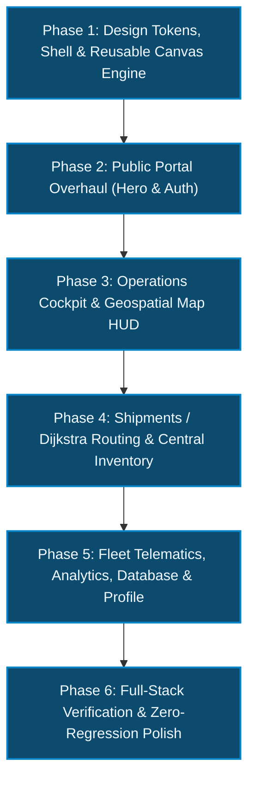

# LogisticsPro Enterprise: Phased Implementation Plan

> [!IMPORTANT]
> **Safety Guarantee**: All changes are structured strictly phase-by-phase. The existing React 19 + TypeScript architecture, Vite bundler configuration, and Node.js (MySQL + MongoDB) REST API integration will remain 100% compatible and functional at every step. Zero code changes will be applied until you explicitly say **"start"**.

---

## Architecture & Design Standard

The redesign adopts the cyber-industrial, high-performance logistics aesthetic demonstrated in `LogisticsPro_Complete_Redesign_Mockup.html`:

* **Color Tokens**:
  * `--bg: #06080a` (Deep carbon black)
  * `--bg2: #0d1114` (Elevated card surface)
  * `--bg3: #141a20` (Secondary container)
  * `--ink: #eef2e6` (Off-white high-legibility text)
  * `--mut: #7f8a79` (Muted sage slate)
  * `--volt: #c8ff2e` (Electric volt lime — primary interactive accent)
  * `--hot: #ff5a1f` (Safety flame orange — alerts & near-capacity)
  * `--ok: #3ddc84` (Mint green — active SLA & optimal status)
  * `--cyan: #00f0ff` (Cyan telemetry accent)
  * `--line: rgba(255,255,255,0.09)` (Hairline grid borders)
* **Typography**:
  * Display: `Syne:wght@700;800` (Architectural uppercase headings)
  * Body: `Manrope:wght@400;500;600;700` (Clean modern geometric sans)
  * Monospace / Data: `JetBrains Mono:wght@400;500;700` (Telemetry coordinates, SKUs, and metric chips)
* **Motion & Engineering**:
  * Film grain noise overlay (subtle 6% SVG turbulence)
  * Custom difference cursor (`.cur`) with magnetic lag and button snapping (`data-mag`)
  * Smooth volt-lime screen wipe (`#wipe.go`) on navigation
  * Hardware-accelerated 60 FPS HTML5 Canvas geospatial engine (`NetworkCanvas`) for Pan-India freight topologies and real-time Dijkstra path visualization

---

## Phased Rollout Breakdown

---

### Phase 1: Foundation, App Shell & Reusable Geospatial Engine
* **Objective**: Establish the design system tokens, typography, cursor physics, screen wipe, and app shell layout without breaking any routes.
* **Detailed Steps**:
  1. **Google Fonts & Meta (`frontend/index.html`)**:
     * Add preconnect and link for `Syne`, `Manrope`, and `JetBrains Mono`.
     * Update title and ensure favicon integration.
  2. **Global CSS & Design Tokens (`frontend/src/index.css`)**:
     * Configure CSS root variables (`--bg`, `--bg2`, `--volt`, `--hot`, `--ok`, `--line`).
     * Add film-grain background pseudo-element and custom scrollbar rules.
     * Configure cursor styling (`.cur`), screen wipe animation (`#wipe`), and card spotlight radial gradients.
  3. **Reusable Interactive Components (`frontend/src/components/common/`)**:
     * `NetworkCanvas.tsx`: Standalone React component wrapping the 60 FPS HTML5 Canvas India Freight Topology engine (14 Indian cities, Haversine spherical math, real-time autonomous truck movements, Dijkstra route illumination, and responsive canvas auto-resizing).
     * `CustomCursor.tsx`: Lagging dual-ring difference-blend cursor with hover magnetic tracking.
  4. **App Shell Overhaul (`frontend/src/components/layout/AppLayout.tsx`)**:
     * Pinned dark sidebar with glowing route icons (`Dashboard`, `Warehouses & Map`, `Inventory`, `Shipments`, `Fleet`, `Analytics`, `Database Live View`, `Profile`).
     * Live database status pill (MySQL + MongoDB Connected), active operator role badge, "+ New Dispatch" button, and mobile bottom navigation.
  5. **Quick Dispatch Modal Modernization (`frontend/src/components/QuickDispatchModal.tsx`)**:
     * Restyle in volt-lime border glow with shortest-path preview card.
* **Verification Checkpoint**: `npm run build` passes with zero errors; sidebar navigates cleanly between existing views.

---

### Phase 2: Public Facing Views (Hero Landing & Authentication)
* **Objective**: Transform public entrypoints into high-impact, brand-defining experiences.
* **Detailed Steps**:
  1. **Hero & Landing Page (`frontend/src/components/views/SplashView.tsx`)**:
     * Giant Syne uppercase typography: `MOVE INDIA FASTER`.
     * Interactive background `NetworkCanvas` running ambient freight trucks.
     * Numbers marquee ticker (`Delhi NCR · Mumbai JNPT · Bengaluru Tech Park...`).
     * Capability bento grid cards (Dijkstra algorithm in 12ms, MySQL+MongoDB architecture, 1.3M sq ft capacity).
     * Interactive routing demo section ("Watch it think").
  2. **Role-Based Authentication (`frontend/src/components/views/AuthView.tsx`)**:
     * Split-screen layout: left side ambient network canvas + brand title; right side high-contrast auth console.
     * 1-Click demo role switcher (`admin`, `manager`, `customer`) that automatically binds credentials to existing `loginWithAuth` context handler and preserves backend JWT session management.
* **Verification Checkpoint**: Seamless sign-in, login redirection, and visual verification of landing page.

---

### Phase 3: Core Operations (Dashboard Cockpit & Indian Freight Map)
* **Objective**: Deliver high-density, real-time operational monitoring.
* **Detailed Steps**:
  1. **Dashboard Cockpit (`frontend/src/components/views/DashboardView.tsx`)**:
     * 4 Volt KPI cards with SVG sparklines (Active Warehouses, Inventory SKUs, Active Shipments, Capacity Occupancy %).
     * Embedded mini `NetworkCanvas` with 60 FPS live truck telemetry.
     * Real-time activity feed connected to `LogisticsContext` and live MongoDB audit stream.
     * Indian Hub capacity load factors with threshold color bars (mint <75%, flame orange 75-90%, crimson >90%).
  2. **Indian Warehouses & Map HUD (`frontend/src/components/views/WarehouseMapView.tsx`)**:
     * Full-screen interactive `NetworkCanvas` supporting quick city focus buttons (`DEL`, `BOM`, `BLR`, `CHE`, `CCU`, `HYD`).
     * Interactive **Hub Inspector** panel showing live GPS coordinates, direct highway corridors, and capacity utilization gauges.
     * Capacity filter pills (Available, Near Full, Critical).
* **Verification Checkpoint**: Dynamic live polling (every 4s) operates smoothly without memory leaks or render stalls.

---

### Phase 4: Order Pipeline & SKU Inventory Intelligence
* **Objective**: Streamline Dijkstra path calculation, order processing, and stock control.
* **Detailed Steps**:
  1. **Shipments & Dijkstra Routing Engine (`frontend/src/components/views/OrderTrackingView.tsx`)**:
     * Origin & destination freight hub dropdowns with instant client-side Dijkstra computation (distance, transit time, fuel consumption).
     * Live `NetworkCanvas` synchronizing illuminated route vectors with active dispatches.
     * Active dispatch orders queue with progress fill bars and priority badges (Critical, High, Medium, Standard).
     * "Process Next in Queue" button connected to backend `/api/process-order`.
  2. **Central Inventory Matrix (`frontend/src/components/views/InventoryView.tsx`)**:
     * Real-time search filter across SKU codes, product names, and hub cities.
     * Data table with stock level fill bars, unit pricing in Indian Rupees (₹), and status chips (In Stock, Low Stock, Out of Stock).
     * Modal trigger for adding new inventory items.
* **Verification Checkpoint**: Verify dispatching orders updates backend queue and inventory balances accurately.

---

### Phase 5: Fleet Telematics, Analytics, Database Inspector & Profile
* **Objective**: Complete all inner views to achieve 100% full-site redesign coverage.
* **Detailed Steps**:
  1. **Fleet & Driver Management (`frontend/src/components/views/FleetView.tsx`)**:
     * Tabbed bento cards for Authorized Drivers (James Wilson, Sarah Connor, Mike Ross with star ratings and assigned vehicles).
     * Fleet vehicle management (Heavy Freight Haulers, Delivery Vans, Autonomous Cargo Drones).
  2. **System Analytics & Reports (`frontend/src/components/views/AnalyticsView.tsx`)**:
     * High-visibility metric cards: Total Network Capacity %, Active Fleet Utilization %, and Dijkstra Fuel Efficiency Optimization.
  3. **Multi-Database Live Explorer (`frontend/src/components/views/DatabaseLiveView.tsx`)**:
     * Real-time snapshot viewer for MySQL and MongoDB.
     * Table switcher tabs (`warehouses`, `inventory`, `orders`, `edges`, `users`) with live data grids and search filter.
  4. **User Profile & Security Console (`frontend/src/components/views/ProfileView.tsx`)**:
     * Operator identity card, instant role switcher, FIDO2 WebAuthn / JWT Bearer token security credentials, and activity audit history.
* **Verification Checkpoint**: Verify all navigation tabs in the sidebar switch instantly without errors.

---

### Phase 6: Full-Stack Verification & Zero-Regression Testing
* **Objective**: Validate build integrity, cross-browser responsiveness, and API health.
* **Detailed Steps**:
  1. Execute `npm --prefix frontend run build` to ensure zero TypeScript errors and optimal Vite bundling.
  2. Test all 10 application routes (`/`, `/auth`, `/dashboard`, `/map`, `/inventory`, `/orders`, `/fleet`, `/analytics`, `/database-view`, `/profile`).
  3. Validate backend API connectivity (`/api/locations`, `/api/edges`, `/api/orders`, `/api/inventory`, `/api/admin/database-view`).
  4. Confirm smooth mobile and desktop responsiveness.
